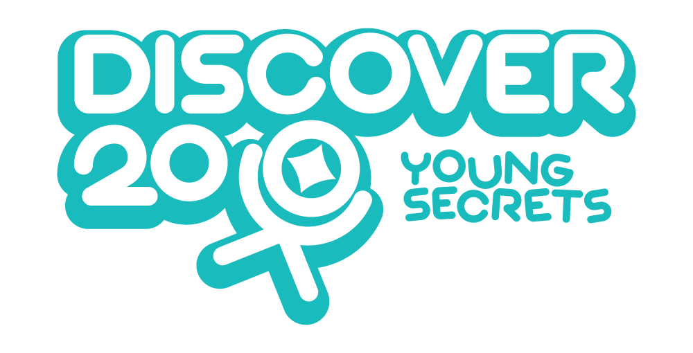

  

<h1 align="center">Young Secrets… Great Solutions</h1>

  <b>A bilingual (Arabic–English) early-childhood development platform for parents in the MENA region.</b> 
  A free development assessment first, then <b>20 minutes a day</b> of the right play for every child.

  🌐 <a href="https://discover20.com"><b>discover20.com</b></a> &nbsp;·&nbsp;
  📸 <a href="https://www.instagram.com/discover20_"><b>Instagram</b></a> &nbsp;·&nbsp;
  ✉️ <a href="mailto:info@discover20.com"><b>info@discover20.com</b></a>

---

### 🌱 What we do

| | |
|---|---|
| 🧩 **Development assessment** | A free check of the child's development to see where they are today |
| ⏱️ **20 minutes a day** | A simple daily plan of activities, stories and toy ideas matched to the child's age |
| 📈 **Progress tracking** | Milestones and check-ins that show how the child is growing |
| 👩‍⚕️ **Experts** | Access to child psychologists, parenting coaches and nutrition consultants |
| 🃏 **Ask & Discover cards** | Cards that take play off the screen and into real life |

### 🎨 Our brand

  
  
  
  
  

Fonts: **Nunito** (Latin) and **Tajawal** (Arabic).

### 📂 Repositories

- [**discover20**](https://github.com/discover-20/discover20) — the Discover20 design system and public website pages

  

